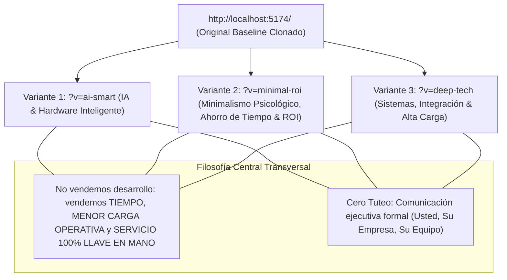

# LSOFT Servicios Informáticos — Status Quo, Arquitectura & 4 Variantes de Valor

> **Fecha:** Octubre 2026  
> **Proyecto:** Plataforma Multivariante de Modernización LSOFT  
> **Repositorio Frontend:** React + Vite (`/Users/vicho/Proyectos/LsoftServicios`)  
> **URL Base Local:** `http://localhost:5174/`

---

## 1. Visión General: El Enfoque de 4 Variantes

Para satisfacer las distintas tipologías de clientes y decisores sin limitarse a un único público, la solución cuenta con **4 opciones completas e independientes** accesibles tanto desde la raíz como mediante el selector flotante interactivo y parámetros URL:



---

## 2. Ajustes Estratégicos y Pulido Editorial Aplicado

Conforme a las directrices de calidad y posicionamiento corporativo de LSOFT:

1. **Erradicación Total del Tuteo:**  
   Se eliminó cualquier expresión en segunda persona informal (*"tú"*, *"tus"*, *"te"*, *"tienes"*, etc.) en todas las vistas y componentes. El lenguaje es estrictamente formal, ejecutivo y respetuoso (*"usted"*, *"su empresa"*, *"su equipo"*, *"nuestra organización"*), transmitiendo solidez y seriedad comercial B2B.

2. **Variante 2 (Minimalismo & ROI) Transversal a Todo el Mercado:**  
   Se descartó cualquier enfoque sesgado a soluciones específicas (como generación de facturas o documentos). El mensaje central es la **metodología de 4 fases:**
   $$\text{Análisis de Operaciones} \longrightarrow \text{Propuesta a la Medida} \longrightarrow \text{Automatización Efectiva} \longrightarrow \text{Ahorro de Tiempo y Escalabilidad}$$  
   Se implementó la **transformación del cuello de botella en ventaja competitiva:** el punto más lento de la operación de una empresa determina su velocidad total de crecimiento; al resolverlo de forma integral, la empresa gana agilidad, liquidez y capacidad de escala con la misma dotación.

3. **Variante 3 (Sistemas y Arquitectura) Aterrizada y Comprensible:**  
   Se redujeron tecnicismos crípticos innecesarios y se calibró el discurso técnico hacia lo que realmente importa al liderazgo de TI y Operaciones:
   - **Integrabilidad limpia con sistemas existentes:** Conexión fluida con ERPs (SAP, Softland, Defontana), bases de datos y software legado, sin obligar al cliente a rehacer todo ni cambiar de herramientas.
   - **Adaptación a la cultura y dinámicas de trabajo actuales:** Respeto por los flujos existentes de la empresa, evitando disrupciones o resistencias al cambio.
   - **Soporte de alta carga y concurrencia:** Resiliencia ante picos de demanda y temporadas altas con 99.99% de disponibilidad.
   - **Hardware con respaldo local (*offline*):** Dispositivos biométricos, POS y sensores que continúan operando ante caídas de red y sincronizan automáticamente.

---

## 3. Detalle de las 4 Opciones Implementadas

### Opción 0: Original LSOFT (Base Clonada 1:1)
- **URL Directa:** `http://localhost:5174/` (o `?v=original`)
- **Propósito:** Preservar la versión actual fidedigna como punto de referencia y control comparativo.
- **Componentes:** Header con scroll dinámico, Hero con drifting de red, 6 servicios clásicos (con corrección de glifos vectoriales MDI), experiencia en 3 etapas, 6 categorías de tecnologías, contacto con WhatsApp y formulario, footer corporativo. Tratamiento formal estandarizado.

---

### Opción 1: IA Integrada, Automatización & Hardware Inteligente
- **URL Directa:** `http://localhost:5174/?v=ai-smart`
- **Público Objetivo:** Dueños de empresa, gerentes de operaciones y organizaciones con flujos manuales y dependencias físicas.
- **Tono / Mensaje:** *"No vendemos desarrollo. Entregamos tiempo y menor carga operativa para su empresa. Servicio 100% resuelto de inicio a fin."*
- **Aestética:** Deep navy de alta tecnología (`#080f1d`), cian eléctrico (`#38bdf8`) y badges de impacto.
- **Demos Interactivas en Vivo (Zona de Soluciones en Acción):**
  1. **Chatbot con IA & Conexión ERP:** Simulador de asistente que consulta stock de bodegas, genera cotizaciones instantáneas y rastrea órdenes con datos en tiempo real.
  2. **Automatización de Flujos:** Visualizador de pipeline operativo que procesa solicitudes, valida reglas de negocio y actualiza sistemas sin intervención manual.
  3. **Hardware & Dispositivos de Terreno:** Simulador de dispositivos biométricos de acceso, terminales POS y sensores de almacenamiento con respaldo ante caídas de red.

---

### Opción 2: Minimalismo Psicológico, Ahorro de Tiempo & ROI
- **URL Directa:** `http://localhost:5174/?v=minimal-roi`
- **Público Objetivo:** Gerentes generales, directores financieros (CFOs) y tomadores de decisiones estratégicas.
- **Tono / Mensaje:** *"No se trata de adquirir software. Se trata de ganar tiempo, reducir la carga de su equipo y transformar sus cuellos de botella en ventajas competitivas."*
- **Psicología Visual:** Fondo ultra limpio blanco/marfil (`#fafbfc`), tipografía pizarra (`#0f172a`), y acentos en verde esmeralda (`#059669` / `#10b981`) que evocan ganancia, seguridad y crecimiento.
- **Herramientas Clave:**
  - **Calculadora Interactiva de Retorno Operativo (ROI):** Sliders de tamaño de equipo y horas operativas diarias; proyecta en tiempo real las horas mensuales recuperadas y el capital operativo mensual recuperable en pesos chilenos ($ CLP).
  - **Matriz de Transformación del Cuello de Botella:** Contraste frontal entre el impacto de un cuello de botella sin resolver (sobrecarga de personal clave, demoras comerciales, techo artificial) versus el cuello de botella transformado en ventaja competitiva (agilidad comercial, colaboradores enfocados en alto valor, escala sin aumentar costos fijos).
  - **Metodología de 4 Etapas:** Diagnóstico $\rightarrow$ Solución a la Medida $\rightarrow$ Automatización Efectiva $\rightarrow$ Ahorro de Tiempo y Escalabilidad.

---

### Opción 3: Sistemas, Integración & Soporte de Alta Carga
- **URL Directa:** `http://localhost:5174/?v=deep-tech`
- **Público Objetivo:** CTOs, Gerentes de TI, líderes de operaciones y empresas con alta concurrencia transaccional.
- **Tono / Mensaje:** *"Arquitecturas Robustas, Integradas a sus Sistemas Actuales & Preparadas para Crecer sin Caídas."*
- **Aestética:** Obsidian dark (`#050811`), rejilla cibernética sutil, neón cian (`#00f0ff`), violeta eléctrico (`#8b5cf6`) y tipografía técnica legible.
- **Herramientas Clave:**
  - **Architecture Blueprint Viewer (Capas Integrables):**
    - *01. Integración con Sistemas Existentes:* Conexión directa a ERPs (SAP, Softland, Defontana) y bases de datos corporativas sin forzar migraciones traumáticas.
    - *02. Conectividad Hardware & Terreno:* Terminales biométricos, POS y sensores con memoria local y sincronización automática tras contingencias de red.
    - *03. Motor de IA Aplicada & Automatización:* Asistentes privados y automatización respetando la cultura y procedimientos actuales.
    - *04. Nube, Alta Carga & Continuidad Operativa:* Arquitectura tolerante a fallas, balanceo de carga y 99.99% SLA para picos de tráfico.
  - **Consola de Monitoreo y Diagnóstico en Vivo:** Terminal interactiva para verificar el estado de los sistemas (`lsoft status --sistemas`, `lsoft hardware --test-dispositivos`, `lsoft carga --simular-pico`).
  - **Principios de Implementación:** Respeto a la cultura y flujos de trabajo de la organización, seguridad y cifrado integral, acompañamiento técnico de par a par.

---

## 4. Selector Flotante de Variantes (`VariantSwitcher`)

En la esquina inferior derecha de la pantalla se ubica un componente flotante tipo pastilla (*pill*) que:
1. Muestra la variante activa y su descripción conceptual.
2. Despliega un menú modal para navegar entre las 4 versiones en un solo clic.
3. Actualiza el parámetro `?v=` en la URL del navegador permitiendo compartir enlaces directos de cualquiera de las variantes.

---

## 5. Estructura del Proyecto

```
/Users/vicho/Proyectos/LsoftServicios/
├── public/
│   ├── fonts/               # Material Design Icons
│   └── images/              # Logotipos, wsp, gráficos
├── src/
│   ├── components/
│   │   ├── Header.jsx       # Header clon original
│   │   ├── Hero.jsx         # Hero clon original
│   │   ├── Services.jsx     # Servicios clon original (formalizado)
│   │   ├── Experience.jsx   # Experiencia clon original
│   │   ├── Technologies.jsx # Tecnologías clon original
│   │   ├── Contact.jsx      # Contacto clon original (formalizado)
│   │   ├── Footer.jsx       # Footer clon original
│   │   ├── Icons.jsx        # SVGs vectoriales MDI
│   │   ├── VariantSwitcher.jsx # Selector interactivo flotante
│   │   └── variants/
│   │       ├── original/
│   │       │   └── OriginalView.jsx      # Variante 0 (Clon Base)
│   │       ├── ai_smart/
│   │       │   ├── AiSmartView.jsx       # Variante 1 (IA & Hardware)
│   │       │   ├── AiChatDemo.jsx        # Demo Asistente IA + ERP
│   │       │   ├── AutomationFlowDemo.jsx # Demo Pipeline de Procesos
│   │       │   └── HardwareDemo.jsx      # Demo Conectividad Terreno/POS
│   │       ├── minimal_roi/
│   │       │   ├── MinimalRoiView.jsx    # Variante 2 (Minimalismo, Ahorro de Tiempo & ROI)
│   │       │   └── RoiCalculator.jsx     # Calculadora Interactiva de Retorno en CLP
│   │       └── deep_tech/
│   │           ├── DeepTechView.jsx      # Variante 3 (Sistemas, Integración & Alta Carga)
│   │           ├── ArchitectureViewer.jsx # Visor de Capas Integrables
│   │           └── TerminalDemo.jsx      # Monitor de Diagnóstico y Carga
│   ├── styles/
│   │   ├── switcher.css         # Estilos del selector flotante
│   │   ├── variant-ai.css       # Estilos Variante 1
│   │   ├── variant-minimal.css  # Estilos Variante 2
│   │   └── variant-deeptech.css # Estilos Variante 3
│   ├── App.jsx              # Gestor multivariante y sincronizador URL
│   ├── index.css            # Estilos base y variables globales
│   └── main.jsx
├── index.html
├── package.json
└── STATUS_QUO.md
```

---

## 6. URLs de Acceso

- **Original (Clon Referencial):** [`http://localhost:5174/`](http://localhost:5174/) o [`http://localhost:5174/?v=original`](http://localhost:5174/?v=original)
- **Variante 1 (IA & Hardware Inteligente):** [`http://localhost:5174/?v=ai-smart`](http://localhost:5174/?v=ai-smart)
- **Variante 2 (Minimalismo Psicológico & Retorno Operativo):** [`http://localhost:5174/?v=minimal-roi`](http://localhost:5174/?v=minimal-roi)
- **Variante 3 (Sistemas, Integración & Alta Carga):** [`http://localhost:5174/?v=deep-tech`](http://localhost:5174/?v=deep-tech)
